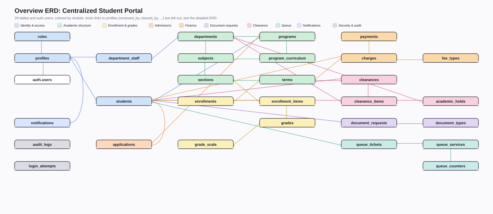
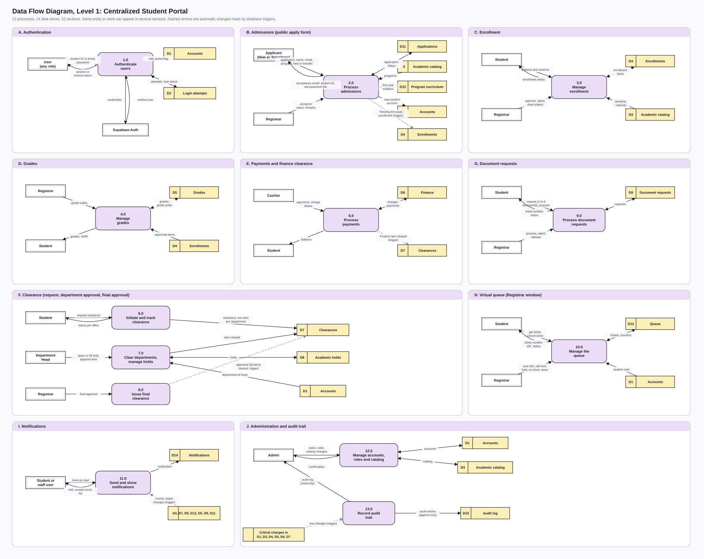
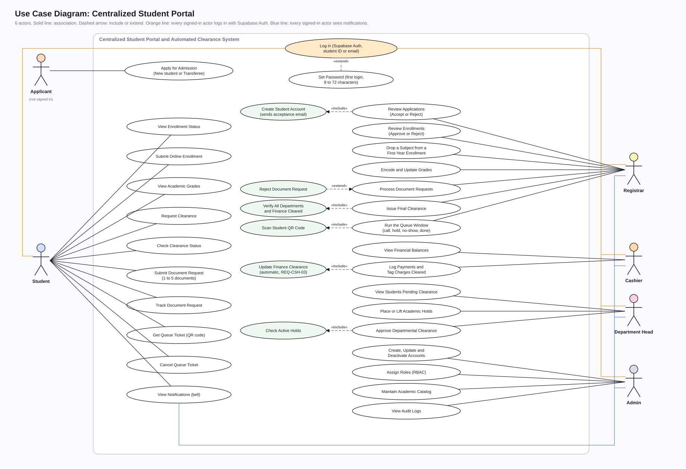
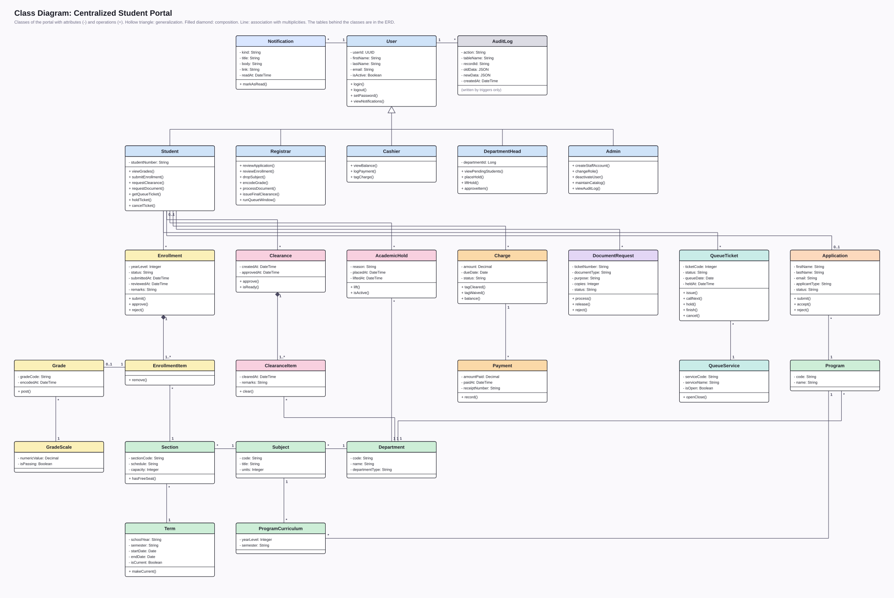

# System Requirements & Project Documentation

**Project Title:** Centralized Student Portal and Automated Clearance System
**Institution:** Pamantasan ng Cabuyao (PnC) - BS Computer Science
**Project Manager:** Abarquez, Justinbril
**Back-End Developer:** Cruzante, Aaron; Canayong, Ron
**Front-End Developer:** Esgana, Justine; Espedilon, Arvien; Dominado, Byrone
**Project Duration:** 12 Days (Agile, five iterative sprints)
**Tech Stack:** Next.js, Tailwind CSS, Supabase (PostgreSQL), Vercel

---

## Revision Log (v3)

This revision aligns the document with the database design files (`schema.sql`, `Database_Design_ERD_3NF.docx`) and the diagram files (`ERD_overview.svg`, `ERD_detailed.svg`, `DFD_level1.svg`, `UseCase_Diagram.svg`), which are the source of truth. It replaces the earlier v2 log.

| # | Change | Where |
| --- | --- | --- |
| 1 | ERD section rewritten for the 23-table design, using the exact table names of `schema.sql`. Figure 1 is `ERD_overview.svg`; `ERD_detailed.svg` is the full reference. | Part 3, Section 1 |
| 2 | Mermaid DFD and Use Case code replaced by `DFD_level1.svg` and `UseCase_Diagram.svg`, with updated descriptions (10 processes, 10 data stores, 7 sections; 5 actors). | Part 3, Sections 2 and 3 |
| 3 | Added REQ-ADM-04 (academic catalog maintenance). | SRS 3.5 |
| 4 | REQ-STU-06 replaced: students request their term clearance and track its status. The notifications requirement was removed because no table supports it. | SRS 3.1 |
| 5 | Wording and table names aligned with `schema.sql` in: definitions (Hold, Clearance Item), user classes (Cashier, Admin), assumption on Finance, REQ-REG-03, REQ-CSH-02, REQ-CSH-03, REQ-DPT-03, REQ-ADM-01, REQ-ADM-03. | SRS 1.2, 2.1, 2.2, 3.2 to 3.5 |
| 6 | Edits outside the requested sections, listed in full below the table. | Charter, SRS, Part 4 |
| 7 | Review fixes: SEC-02 `users` replaced by `profiles`; "ERD v2" changed to "ERD v3" (Phase 2 row, `types/` note); Financial Tracking objective reworded; Phase 1 date marked with a TODO comment (date unchanged). | Charter, SRS 4.1, Part 4 |
| 8 | Development methodology changed from Rapid Application Development (RAD) to Agile. RAD wording replaced in the header, team roles and SRS 2.2; new Charter section 7 describes the Agile process. | Header, Charter 4 and 7, SRS 2.2 |
| 9 | Charter section 7 replaced by the full SDLC plan (7.1 to 7.7). Sprint 2 ended Oct 10 instead of Oct 5; carry-over is recorded in 7.3. Phase 1 TODO comment removed (Sprint 1 end date is Oct 2). | Charter 6 and 7 |
| 10 | Added the Activity Diagram (term clearance) and the Class Diagram (generated from `schema.sql`) as Part 3, Sections 4 and 5. | Part 3 |
| 11 | Sprint 3 was compressed to one day (Oct 11) and delivered the clearance slice on live data: grants for the clearance objects, the three database triggers (department approval needs no active hold, the Finance item clears automatically, final clearance needs every item cleared), the Student, Department, Cashier and Registrar clearance screens, the Admin audit log, and the end-to-end test with `docs/testing-plan.md`. Carried over (still mock data, labelled "Sample data"): REQ-REG-01, REQ-REG-02, REQ-REG-04, REQ-STU-02, REQ-STU-04, REQ-STU-05, REQ-DOC-01, REQ-DOC-02, REQ-ADM-01, REQ-ADM-04; not done: SEC-03 (login lockout), SEC-04 (rate limiting). Section 6 and 7.3 show the real Sprint 3 date. (This row records the state of Oct 11; the carried-over items are updated in row 12.) | Charter 6, SDLC 7.3, `docs/sprint-3-plan.md` |
| 12 | Sprint 4 (Oct 12 to 15; the final deadline is Oct 15, 2026). The plan slipped: Sprint 4 was planned to end Oct 10 and Sprint 5 on Oct 12, but Sprint 3 and the earlier sprints ran late, so Sprint 4 now covers integration, QA, security hardening, the professor's tasks, the paper and the release (freeze midday Oct 15), and there is no separate Sprint 5. Status on Oct 12, 2026. **Done and live in the database:** login lockout with exponential backoff, SEC-03 (PR #117, merged; tests TC-72 to TC-82); grades rules (PR #118, merged; issue #92); document request rules (PR #118, merged; issue #93); enrollment rules (issue #94, PR #119). **Built:** live screens for student grades, student documents, student enrollment, Registrar grades, Registrar documents and Registrar enrollments (issues #97 to #102, PR #119). They were tested in the browser, except the student enrollment forms, the Registrar Reject button and the error messages, which are not yet tested. PR #119 is merged into `dev`; it is not yet merged into `main`, so the live Vercel site does not show these screens until the Project Manager merges `dev` into `main`. **Security finding fixed:** the Supabase helper `rls_auto_enable()` was executable by the `anon` role. **In progress:** the Vercel firewall rate limit rule, SEC-04 (issue #91); no evidence yet that it is live. **Still open or carried over (still "Sample data" where a screen exists):** catalog rules and screen (REQ-ADM-04), Admin user accounts (REQ-ADM-01, decision pending), dashboards on sample data, unit tests, performance test, ethical analysis, final paper, and teammate reviews (none of the PRs has had a teammate review yet). Done now and removed from the carried-over list: REQ-REG-01, REQ-REG-02, REQ-REG-04, REQ-STU-02 (grades and enrollment status; dashboard parts are still sample data), REQ-STU-04, REQ-STU-05, REQ-DOC-01, REQ-DOC-02. | Charter 6, SDLC 7.1 and 7.3, SRS 4.1 (status), Known gaps |
| 13 | Document and diagram sync (Oct 14, 2026), after the system changed a lot. The text and the diagrams were checked against the live system and `docs/database/*.sql`. **Database:** 29 tables in 10 modules (6 new since v3: `applications`, `program_curriculum`, `queue_services`, `queue_tickets`, `queue_counters`, `notifications`), 47 foreign keys (including `profiles` to `auth.users`), 4 views. **Requirements:** new REQ-APP-01 to 03 (public application and admissions), REQ-QUE-01 to 04 (virtual queue), REQ-NOT-01 (notifications), SEC-07 (password rules) and SEC-08 (security headers); reworded REQ-STU-01, 04, 05, REQ-REG-04, REQ-DOC-01, REQ-ADM-01; the notifications requirement removed in row 4 is back because the table now exists. **Diagrams** redrawn from the SQL files with `scripts/diagrams/`: Overview ERD and Detailed ERD (29 tables), Class Diagram (28 classes, UML: attributes, operations, generalization, multiplicities), DFD level 1 (13 processes, 14 data stores, 10 sections), Use Case diagram (6 actors); the Activity Diagram (term clearance) was checked and is unchanged. Editable copies of all six diagrams are in the Figma file https://www.figma.com/design/caIH5zcYI3ursQ9c2iYFJg. **App:** the mock data files and the "Sample data" label were removed because every screen now reads live data (Student dashboard in PR #154); the Admin screens and the Registrar and Admin dashboards are in `dev` (PR #153). Status items are as of Oct 14, 2026, evening. | Charter 3 and 4, SRS 1.2, 2, 3 and 4, Part 3, Part 4, Known gaps |


**Row 6 details (edits outside the sections I was asked to edit):**

* Charter, Section 5: removed the caption line "Table data sourced from Project Charter."
* Charter, Section 6 (schedule): Phase 2 row now starts with "ERD v3 finalized and migrated (see Revision Log)"; Phase 3 row has an added sentence on starting the clearance logic first. No dates were changed.
* SRS 1.2: the Hold definition was reworded and a Clearance Item row was added.
* SRS 2.1: the Cashier, Department Head, and Admin rows were reworded.
* SRS 2.2: added the assumption that Finance is a department row (the Cashier's Office).
* SRS 3.1: REQ-STU-03 now ends with "including Finance".
* SRS 3.2 to 3.5: REQ-REG-01, REQ-REG-03, REQ-CSH-01, REQ-CSH-02, REQ-CSH-03, REQ-DPT-01, REQ-DPT-02, REQ-DPT-03, REQ-ADM-01, REQ-ADM-02, and REQ-ADM-03 were reworded or extended.
* SRS 4.1 (security requirements): SEC-02, SEC-03, SEC-04, and SEC-06 were extended. SEC-01 and SEC-05 are unchanged.
* Part 4, First-Time Installation: the italic note on `.env.local` was joined into plain sentences, and a "Backend developers only" bullet on `SUPABASE_SERVICE_ROLE_KEY` was added.
* Part 4, folder structure: the `types/` note now says to regenerate the types after the ERD v3 migration.
* Part 4, Deployment: added the GitHub branch-protection bullet.
* Formatting: blank lines were added between list items and table rows in several sections (no wording change).
---

## Part 1: Project Charter

### 1. Executive Summary

This project delivers a comprehensive, web-based university portal designed to eliminate physical queuing for enrollment, automate the student clearance process, and centralize grade viewing and document requests. Due to the accelerated 12-day deadline, the system uses a decoupled Backend-as-a-Service (BaaS) architecture to ensure rapid deployment, scalability, and security without sacrificing architectural integrity.

### 2. Project Objectives

* **Digitize Enrollment:** Allow students to submit their enrollment (subject and section selection) online and allow the Registrar to review and approve it, removing the need for physical queuing.

* **Automate Clearances:** Reduce physical clearance processing time by digitizing approvals across academic and financial departments.

* **Centralize Academic Data:** Provide a secure portal for students to view grades and academic standing in real time.

* **Streamline Requests:** Implement a ticketing system for document requests (e.g., Transcript of Records, Certificates) to eliminate physical line queuing.

* **Modernize Financial Tracking:** Enable the Cashier module to digitally tag payments and automatically clear the Cashier's Office clearance item once payment is recorded.

### 3. Project Scope

**In-Scope:**

* Development of 6 core modules: Student Portal, Registrar, Cashier, Department, Admin, and Document Request System, plus three features added in Sprint 4: the public application and enrollment site (Admissions), the virtual queue for the Registrar window, and in-app notifications.

* Online enrollment submission (Student Portal) and enrollment approval (Registrar), as covered in the SRS.

* Database design normalized to the Third Normal Form (3NF).

* Role-Based Access Control (RBAC) ensuring strict data isolation.

* Implementation of system security protocols: Rate Limiting, Row Level Security, Brute-Force Protection, and SQL Injection prevention (parameterized queries).

* Live cloud deployment via Vercel.

**Out-of-Scope:**

* Integration with external payment gateways (credit cards, e-wallets); cashier transactions will be manually tagged by staff for this phase.

* Hardware procurement or physical kiosk setup.

### 4. Team Structure and Roles

* **Project Manager / Systems Analyst (1):** Acts as Product Owner and Scrum Master (manages the backlog, sprint plan and timeline), designs the system models (DFD, Use Case, Activity, and Class Diagrams), writes the SDLC plan, test plan, and ethical analysis, compiles the final IEEE documentation in parallel with development, and is the only person who merges dev into main for deployment.

* **Frontend Developers (3):** Develop UI/UX wireframes and storyboards and build responsive Next.js/Tailwind CSS components first on mock data for rapid prototyping; the mock data files were deleted on Oct 14, 2026 because every screen now reads live data.

* **Backend / Database Developers (2):** Own the ERD and 3NF PostgreSQL schemas, configure Supabase Authentication, implement Row Level Security (RLS) policies, build login lockout and rate limiting, implement the audit log, and connect live APIs.

* *Ownership note:* The PM reviews the ERD for consistency with the Class Diagram, but the Backend team is the owner of the ERD and 3NF tables so the work is not duplicated.

### 5. Deliverable Ownership

| Deliverable | Owner | Support |
| --- | --- | --- |
| SDLC Plan | Project Manager | - |
| DFD, Use Case, Activity, Class Diagrams | Project Manager | Backend team (review) |
| UI/UX Storyboard and Wireframes | Frontend team | Project Manager (review) |
| ERD and 3NF Tables | Backend team | Project Manager (review) |
| Software Testing Plan and Test Cases | Project Manager | All developers (unit tests for own modules) |
| Ethical Analysis | Project Manager | All members (input) |
| Prototype and Live Deployment | Backend team and Project Manager | Frontend team |
| IEEE References, Verification Reports, Team Monitoring Sheet | Project Manager | All members (peer evaluation) |

### 6. Milestone Schedule

| Phase | Description | Target Date |
| --- | --- | --- |
| **Sprint 1** | System modeling (DFD, Use Case, Activity, Class), ERD/3NF design, UI/UX wireframes, database initialization. | Oct 2 |
| **Sprint 2** | ERD v3 finalized and migrated (see Revision Log), Auth setup, Role-Based Access Control (RLS), Admin/Student UI layouts, SDLC plan draft. | Oct 5 (completed Oct 10) |
| **Sprint 3** | Registrar (Grades/Docs/Enrollment), Cashier, and Department (Clearance) modules connected; Admin audit log implemented. Clearance logic (holds, department approval, final clearance) is started first because the modules depend on it. | Oct 8 (compressed to one day, done Oct 11: clearance slice only, see Revision Log) |
| **Sprint 4** | Integration, QA testing, security hardening (SQL injection checks, login lockout, rate limiting, vulnerability patching), software testing plan and ethical analysis finalized. | Oct 10 (planned); the plan slipped: Sprint 4 runs Oct 12 to 15 and also carries the work of Sprint 5 (see Revision Log row 12). Status of Oct 14, evening: release #152 is live on `main`; `dev` is ahead with the Admin screens and the live dashboards (PRs #153 and #154) |
| **Sprint 5** | Live deployment to Vercel (dev merged into main by the PM), IEEE final paper compilation, plagiarism check, AI/anti-AI detector report, Team Monitoring Sheet (peer evaluation), final review. | Oct 12 (planned); merged into Sprint 4. Final deadline and freeze: Oct 15, midday |

### 7. Development Methodology (Agile)

The project follows an Agile (Scrum-style) approach: the work is delivered in five short sprints, and each milestone phase in the schedule above is one sprint. Section 7 is the SDLC plan of the project.

#### 7.1 Why Agile

The project has a fixed final deadline (originally Oct 12, now Oct 15, 2026) and a short window, and several parts depend on each other (authentication, then clearance, then the modules). Short sprints let the team show working software from the `dev` branch at the end of every phase, find integration problems early, and re-prioritize when a sprint runs late. A plan-driven (waterfall or RAD) approach would find those problems only at the end.

#### 7.2 Phases

| Phase | Activities | Output |
| --- | --- | --- |
| Planning and requirements | Project Charter, SRS, requirement IDs (REQ, SEC, PER, ETH) | This document |
| Design | DFD, Use Case diagram, ERD/3NF, UI/UX wireframes in Figma | `docs/diagrams` (SVG, regenerated by `scripts/diagrams/`), Figma file `Cabuyao_Uni` (screens), Figma file for the six diagrams (https://www.figma.com/design/caIH5zcYI3ursQ9c2iYFJg) |
| Implementation | Next.js 16 (App Router, TypeScript), Tailwind CSS 4, Supabase (PostgreSQL, Auth, Row Level Security) | `main` and `dev` branches |
| Testing | Role-routing and data-isolation tests, security tests (SQL injection, brute force, rate limiting, RLS), integration testing | `docs/testing-plan.md` |
| Deployment | Vercel deploys every change to `main` | Live prototype |
| Documentation and review | IEEE paper, plagiarism and AI-detector reports, Team Monitoring Sheet | Final deliverables |

#### 7.3 Sprints

| Sprint | Goal | Planned end |
| --- | --- | --- |
| Sprint 1 | System modeling, ERD/3NF design, UI/UX wireframes, database initialization | Oct 2 |
| Sprint 2 | ERD v3 migrated, authentication and role routing, shared UI and dashboard shell, SQL files committed, SDLC plan | Oct 5 (completed Oct 10) |
| Sprint 3 | Clearance logic first (holds, department approval, Cashier auto-clear, final approval; database triggers), then the Registrar, Cashier and Department modules and the Admin audit log | Oct 8 (compressed to one day, done Oct 11: the clearance slice on live data; the other modules carried over) |
| Sprint 4 | Integration, QA, login lockout and rate limiting (SEC-03, SEC-04), testing plan and security tests; since the slip also the professor's tasks, the final paper and the release | Oct 10 (planned; the testing plan for the clearance slice was delivered Oct 11). Actual: Oct 12 to 15, in progress; freeze midday Oct 15 (status of Oct 14: see 7.8) |
| Sprint 5 | Vercel deployment from `main`, IEEE paper, verification reports, Team Monitoring Sheet | Oct 12 (planned). Merged into Sprint 4; final deadline Oct 15, 2026 |

Sprint 2 ended later than planned, and Sprint 3 was compressed to one day (Oct 11). Sprint 4 did not end on Oct 10 as planned: it started on Oct 12 and ends with the freeze on Oct 15, and Sprint 5 no longer exists as a separate sprint. The unfinished work and the shifted dates are recorded in the Revision Log (rows 9, 11 and 12). What Sprint 3 delivered and what was carried over is in `docs/sprint-3-plan.md`.

#### 7.4 Roles

| Role | Members | Responsibility |
| --- | --- | --- |
| Product Owner and Scrum Master | Abarquez, Justinbril | Backlog order, sprint reviews, merges `dev` into `main` |
| Backend team | Cruzante, Aaron; Canayong, Ron | Database, RLS, authentication, triggers, security |
| Frontend team | Esgana, Justine; Espedilon, Arvien; Dominado, Byrone | UI from the Figma design, module screens |

#### 7.5 Backlog by dependency

1. Authentication and role-based access (SEC-01, SEC-02, REQ-ADM-02)
2. Shared UI, navigation and dashboard shell
3. Clearance chain: holds, department approval, Cashier auto-clear, final approval (REQ-CSH-03, REQ-REG-03) and audit logging (REQ-ADM-03)
4. Module screens: Student, Registrar, Cashier, Department, Admin (REQ-STU, REQ-REG, REQ-CSH, REQ-DPT, REQ-ADM, REQ-DOC)
5. Security hardening: lockout, rate limiting, injection checks (SEC-03 to SEC-05)
6. Deployment and final documents

#### 7.6 Branching and deployment flow

1. Nobody codes directly on `main` or `dev`.
2. Each task gets a branch from `dev` named `feature/<task>` (or `chore/<task>`, `docs/<task>`).
3. The author opens a pull request with base `dev`; at least one teammate reviews it.
4. At the end of a sprint, after the team confirms `dev` is tested, only the Project Manager merges `dev` into `main`.
5. Vercel deploys automatically on every change to `main`. The `service_role` key is kept server-side only (SEC-06).

#### 7.7 Testing approach and risks

Testing is done per sprint on `dev` with the seeded test accounts (one per role, fictional data only, ETH-01 and ETH-02). The full testing plan, including the security tests, is a Sprint 4 deliverable in `docs/testing-plan.md` (the clearance part was delivered Oct 11; sections 7.4 to 7.9 and 10.1 to 10.2.2 were added on Oct 12 to 14).

| Risk | Mitigation |
| --- | --- |
| A sprint runs late and squeezes the next one | Order the backlog by dependency; record carry-over in the Revision Log |
| A pull request is merged into the wrong branch | Check the base branch of every pull request; only the Project Manager merges into `main` |
| Rules between tables are not enforced (clearance chain) | Implement them as database triggers early in Sprint 3 and test each one |
| Keys leak into the repository | `.env.local` is git-ignored; `service_role` never reaches the browser |
| Design and code drift apart | Build screens from the Figma design using the shared design tokens |

#### 7.8 Known gaps (status of Oct 14, 2026, evening)

| Gap | Status |
| --- | --- |
| No teammate has reviewed any pull request (0 reviews on #58 to #154); the Project Manager merged them | Open: ask a teammate to review the merged changes (issue #115) |
| `types/database.types.ts` is written by hand and matches `views.sql`; it was not produced by `supabase gen types` | Open: regenerate from the live project or keep this note |
| `Database_Design_ERD_3NF.docx` (3NF proof and rules R1 to R12, cited in Part 3, Section 1) is not in the repository | Open: the Project Manager adds the file, or the citation is removed |
| Baseline grants on schema `private`, the EXECUTE grants of the SECURITY DEFINER functions and the sequences are not written down in `docs/database/` | Open (see `docs/sprint-3-plan.md`) |
| Login lockout residual risks (listed in `docs/database/login_lockout.sql`): an attacker who knows an email can keep that account locked (denial of service); direct calls to the Supabase Auth endpoint bypass the lockout; parallel requests can exceed the 5-attempt limit before the first lock; the lock state of any email is visible | Open (finding SF-1): on 2026-10-14 a direct call to the Supabase Auth endpoint was seen to skip the lockout; partly mitigated by the rate limit (SEC-04) and Supabase Auth's own limits |
| The Cashier can edit `charges.amount` and `due_date` | Decision: kept on purpose; every change is recorded in `audit_logs` |
| Rate limiting (SEC-04): live as a Vercel firewall rule, tested on the sign-in route only (`docs/rate-limiting.md`); it does not cover direct calls to the Supabase Auth endpoint | Done 2026-10-12 (issue #91); re-tested on the live site 2026-10-14 (40 POST requests: 20 allowed, 20 blocked with HTTP 429); residual limits listed |
| Catalog rules and screens, Admin user accounts, Registrar, Admin and Student dashboards | Built on live data. The Admin screens and the Registrar and Admin dashboards are in `dev` (PR #153); the Student dashboard is PR #154; neither is on `main` until the second release |
| Unit tests, performance test, ethical analysis, final paper | Unit tests UT-01 to UT-128 pass; performance measured on demo-size data from one network (`docs/testing-plan.md` 10.1); `docs/ethical-analysis.md` written, no teammate review yet; final paper not done (issue #113) |
| First-year curriculum, section schedules and capacities are SAMPLE data | Open: the Registrar and Admin replace them with real data through Academic setup |
| Browser tests of the enrollment forms, first-year enrollment, the queue and documents | Recorded in `docs/testing-plan.md` 7.4 to 7.9. Still unverified on the live site: first-year enrollment end to end, saving a valid password, a real hold with the No-show button, a request for two documents, the Registrar's scan camera on a phone |
| Release #152 (Oct 14) put the Sprint 4 screens, first-year enrollment, the queue and the security headers on `main` (live). `dev` is ahead with PRs #153 and #154 | Open: second release, `dev` into `main`, by the Project Manager |

## Part 2: Software Requirements Specification (SRS)

### 1. Introduction

**1.1 Purpose**
This document specifies the software requirements for the Centralized Student Portal and Automated Clearance System. It defines the functional and non-functional requirements to guide the development team and provide a clear baseline for the academic evaluation of the live prototype.

**1.2 Definitions, Acronyms, and Abbreviations**

| Term | Definition |
| --- | --- |
| **RBAC** | Role-Based Access Control: access to features and data is determined by the user's role. |
| **RLS** | Row Level Security: PostgreSQL feature that restricts which rows a user can read or modify. |
| **BaaS** | Backend-as-a-Service: hosted backend (Supabase) providing database and authentication. |
| **3NF** | Third Normal Form: a database normalization level that removes redundant and transitively dependent data. |
| **Hold** | A block placed on a student by an academic department (table `academic_holds`). It stays active until lifted. A department can clear its clearance item only when the student has no active hold from that department. |
| **Clearance Item** | One required sign-off per department for a student's term clearance (table `clearance_items`), including the Financial office (the Cashier's Office). The Registrar can approve the clearance only when every item is cleared. |
| **Ticket** | A unique tracking record created for each document request. |
| **Queue ticket** | A place in the virtual queue of a Registrar window (table `queue_tickets`). The line order is an internal number; the 7-digit code people see is random. |
| **Application** | A request from a person without an account (New student or Transferee) to enroll, kept in `applications` until the Registrar accepts or rejects it. |
| **SRS** | Software Requirements Specification. |

### 2. System Overview

The system is a cloud-native web application using Next.js for the frontend and Supabase (PostgreSQL) for the backend database and authentication. It facilitates secure data flow between students and university staff, ensuring that enrollment, clearance, and document retrieval processes are digitized, role-restricted, and secure.

**2.1 User Classes**

| User Class | Description |
| --- | --- |
| **Student** | Enrolled student who views grades, enrollment status, clearance, submits requests, and gets a queue ticket for the Registrar window. |
| **Registrar** | Reviews applications, approves enrollment, encodes grades, processes document requests, runs the queue window, and issues final clearance. |
| **Cashier** | Views balances, logs payments, and tags charges as Cleared or Waived, which clears the Financial office's clearance item. |
| **Department Head** | Assigned to one department. Reviews students pending clearance for that department, places or lifts that department's holds, and approves departmental clearance. |
| **Applicant** | A person without an account who sends an application on the public form. Not a signed-in user class. |
| **Admin** | Manages user accounts and roles, maintains the academic catalog, and reviews the audit log. |

**2.2 Assumptions and Constraints**

* The project must be delivered within a 12-day schedule, using Agile development in five short sprints.

* The system is built on Next.js, Tailwind CSS, Supabase (PostgreSQL), and Vercel.

* Payments are manually tagged by Cashier staff; no external payment gateway is integrated.

* Users have internet access and a modern web browser.

* University-issued credentials are provisioned through Supabase Auth: for students automatically when the Registrar accepts an application, for staff by the Admin.

* Finance is modeled as a department (the seeded row "Cashier's Office" in `departments`, with type Financial) so that its clearance item works like the items of academic departments. Holds are placed only by academic departments.

**2.3 External Interfaces**

* **User interface:** Responsive web UI built with Next.js and Tailwind CSS, accessible by browser.

* **Database/Auth interface:** Supabase client (HTTPS) for PostgreSQL queries and Supabase Auth.

* **Hosting interface:** Vercel continuous deployment from the GitHub repository.

* **Email interface:** Resend sends the acceptance email. In the prototype the free plan delivers only to the Project Manager's own address.

### 3. Functional Requirements

**3.1 Student Portal Module**

* **REQ-STU-01:** The system shall allow students to log in with their student ID (8 digits, with or without the hyphen) or their email, and staff to log in with their email, using university-issued credentials. A new user sets a password through the link in the acceptance email.

* **REQ-STU-02:** The system shall display the student's current enrollment status and academic grades securely.

* **REQ-STU-03:** The system shall provide a dashboard showing the real-time status of the student's clearance across all departments, including Finance.

* **REQ-STU-04:** The system shall allow students to submit requests for specific academic documents (one to five documents in one submission, each with its own ticket) and track the request status.

* **REQ-STU-05:** The system shall allow students to submit an online enrollment (select subjects and sections for the term) and track its approval status. The first-year enrollment of a new student is created automatically from the program's curriculum, and the student cannot change it; the Registrar can drop a subject (REQ-REG-04).

* **REQ-STU-06:** The system shall allow students to request their term clearance and track its status.

**3.2 Registrar Module**

* **REQ-REG-01:** The system shall allow the Registrar to encode and update student grades for subjects the student is enrolled in.

* **REQ-REG-02:** The system shall allow the Registrar to view and process incoming document requests from students.

* **REQ-REG-03:** The system shall enable the Registrar to issue final clearance approvals only once every clearance item (including the Financial office's item) of that student is cleared.

* **REQ-REG-04:** The system shall allow the Registrar to review, approve, or reject submitted student enrollments, and to drop a subject from a Pending first-year enrollment.

**3.3 Cashier Module**

* **REQ-CSH-01:** The system shall allow Cashier personnel to view a student's outstanding financial balances (total charges minus total payments).

* **REQ-CSH-02:** The system shall allow Cashier personnel to log payments against a student's charges and to tag a charge as "Cleared" (after payments cover its amount) or "Waived".

* **REQ-CSH-03:** The system shall instantly update the student's clearance status when a payment is confirmed: once every charge of the student for the term is Cleared or Waived, the Financial office's clearance item is cleared automatically.

**3.4 Department Module**

* **REQ-DPT-01:** The system shall allow Department Heads to view only the students pending clearance for their own department.

* **REQ-DPT-02:** The system shall allow departments to place or lift specific academic holds (e.g., missing lab equipment, advising required) for their own department only.

* **REQ-DPT-03:** The system shall allow Department Heads to approve departmental clearance for a student once all of that department's holds are lifted. The approval is recorded in `clearance_items` (`cleared_at`, `cleared_by`) and is a prerequisite for REQ-REG-03.

**3.5 Admin Module**

* **REQ-ADM-01:** The system shall provide an Admin interface to create, update, and deactivate user accounts (deactivation sets `profiles.is_active = false` and blocks login, and an account can be reactivated). Student accounts are created by accepting an application; the Admin adds staff accounts, changes a role or department, and can resend the invitation. The last active Admin cannot be deactivated.

* **REQ-ADM-02:** The system shall implement strict Role-Based Access Control (RBAC) assigning users to Student, Registrar, Cashier, Department, or Admin roles. Department users are additionally assigned to a department.

* **REQ-ADM-03:** The system shall maintain a read-only audit log (`audit_logs`) of all critical data changes, written by database triggers. No role, including Admin, may update or delete audit entries.

* **REQ-ADM-04:** The system shall allow the Admin to maintain the academic catalog (departments, programs, terms, subjects, sections).

**3.6 Document Request System**

* **REQ-DOC-01:** The system shall assign a unique tracking ticket to every new document request (a student can request one to five documents at once; each gets its own ticket).

* **REQ-DOC-02:** The system shall update the ticket status automatically when the Registrar processes the document.

**3.7 Admissions (public application and enrollment site)**

* **REQ-APP-01:** The system shall provide a public application form (no login) where an applicant gives a name, an email, an optional mobile number, a program and the applicant type (New student or Transferee). The form shall not reveal whether an email already has an account or an open application, and the number of applications per email and per hour is limited.

* **REQ-APP-02:** The system shall allow the Registrar to accept or reject a Pending application (a rejection needs remarks). Accepting creates the student account with the next student number (`YYYY-NNNN`) and emails the applicant the student ID and a link to set a password.

* **REQ-APP-03:** Accepting a New student shall also create a Pending first-year enrollment with the program's first-year subjects (table `program_curriculum`). A Transferee is not enrolled automatically.

**3.8 Virtual Queue (Registrar window)**

* **REQ-QUE-01:** The system shall show a student a queue pass (a QR code that changes every 15 seconds) and allow one active ticket per student, service (Enrollment or Documents) and day.

* **REQ-QUE-02:** The system shall allow the Registrar to read the QR code (USB scanner or camera), which issues the ticket in the same step, and to call the next ticket and mark it Done or No-show. The code shown to people is a random 7-digit number; the line order is kept separately.

* **REQ-QUE-03:** The system shall show a student their place in the line and an estimated wait, and allow the student to hold their place for up to 30 minutes, to come back, or to cancel the ticket. The Registrar can mark a held ticket No-show only after the hold ran out; expired holds are closed by the database.

* **REQ-QUE-04:** Every ticket change shall be made by a database function that checks the caller's role, and shall be recorded in the audit log (REQ-ADM-03).

**3.9 Notifications**

* **REQ-NOT-01:** The system shall give every signed-in user an in-app inbox with an unread count. Notifications are written by database triggers when a queue ticket, enrollment, document request, clearance item, hold, grade or application changes, and a notification problem shall never block the original action. A user reads only their own notifications.

### 4. Non-Functional Requirements

**4.1 Security Requirements**

* **SEC-01 (Authentication):** Passwords shall not be stored in plaintext. The system shall use Supabase Auth (bcrypt hashing) for all credentials.

* **SEC-02 (Authorization):** The database shall enforce Row Level Security (RLS), enabled on every table, ensuring users can only query data authorized by their specific role. Policies shall read the caller's role and department through a `SECURITY DEFINER` helper function (or JWT custom claims) rather than querying `profiles` directly inside a policy on `profiles`, to avoid recursive policies and slow queries.

* **SEC-03 (Brute-Force Protection):** The system shall implement account lockouts and exponential backoff for multiple failed login attempts. Attempts are recorded in the `login_attempts` table by server-side logic (route handler/middleware) on top of Supabase Auth, and the lockout check runs before credentials are verified. *Status (Oct 12, 2026): live (PR #117, `docs/database/login_lockout.sql`).*

* **SEC-04 (Rate Limiting):** API endpoints shall be rate-limited to prevent Denial of Service (DoS) attacks. Because Vercel runs serverless functions, in-memory counters in Next.js middleware are not reliable; rate limiting shall use the Vercel firewall or a shared store (e.g., Upstash Redis). *Status (Oct 12, 2026): live (Vercel firewall rule, 20 POST requests per minute per IP, HTTP 429; tested, see `docs/rate-limiting.md`).*

* **SEC-05 (SQL Injection):** All database access shall use parameterized queries through the Supabase client. Raw SQL built by string concatenation with user input is prohibited, and all user input shall be validated server-side.

* **SEC-06 (Secret Handling):** The Supabase `service_role` key shall never be used in frontend code or exposed to the browser, and shall never be placed in any `NEXT_PUBLIC_` variable. It may be used only in server-only code (e.g., Next.js route handlers) where privileged access is required, such as login lockout and audit logging, and only via a non-public environment variable. Only the anon key may be used client-side, and environment files (`.env.local`) shall never be committed to the repository.

* **SEC-07 (Password rules):** A password chosen on the set-password page shall be 8 to 72 characters long with a lowercase letter, a capital letter, a number and a special character. The same rule is set in the Supabase Auth settings. Signing in does not re-check the rule, so older passwords keep working.

* **SEC-08 (Security headers):** Every response shall carry `X-Frame-Options: DENY`, a `Content-Security-Policy` with `frame-ancestors 'none'`, `Referrer-Policy`, `X-Content-Type-Options: nosniff` and a `Permissions-Policy` that allows only the camera for the site itself (the Registrar's QR scan). Vercel adds HSTS. A strict script policy is not set (finding SF-3).

**4.2 Performance & Deployment Requirements**

* **PER-01:** The application UI shall load in under 2.5 seconds on standard broadband connections.

* **PER-02:** Database queries for student grades and clearance statuses shall resolve in under 500 milliseconds.

* **PER-03:** The application shall be continuously deployed to a live Vercel production environment automatically upon merging code to the main branch. Merges from dev to main are performed by the Project Manager only.

**4.3 Data Privacy & Ethics**

* **ETH-01:** The system shall comply with standard data privacy principles (e.g., Data Privacy Act of 2012), ensuring student academic records are strictly confidential and inaccessible to peer student accounts.

* **ETH-02:** Data minimization shall be enforced; the system will only collect and display data strictly necessary for enrollment and clearance procedures.

## Part 3: System Architecture & Modeling

### 1. Entity Relationship Diagram (3NF)

The database is defined in `schema.sql` (the first 23 tables) and in the rule files `applications_rules.sql`, `first_year_curriculum.sql`, `queue_rules.sql` and `notifications_rules.sql` (the other 6; PostgreSQL 16 on Supabase), and documented in `Database_Design_ERD_3NF.docx` (data dictionary, normalization proof up to 3NF, and rules R1 to R12). It has 29 tables in 10 modules, one external table (Supabase `auth.users`), 47 foreign keys (including `profiles` to `auth.users`), and 4 views (`v_clearance_items`, `v_clearances`, `v_active_holds`, `v_grades`). The tables, by module:

* **Identity & Access:** `roles`, `profiles`, `students`, `department_staff`.
* **Academic Structure:** `departments`, `terms`, `programs`, `subjects`, `sections`, `program_curriculum`.
* **Enrollment & Grades:** `grade_scale`, `enrollments`, `enrollment_items`, `grades`.
* **Finance:** `fee_types`, `charges`, `payments`.
* **Document Requests:** `document_types`, `document_requests`.
* **Clearance:** `clearances`, `clearance_items`, `academic_holds`.
* **Admissions:** `applications`.
* **Queue:** `queue_services`, `queue_tickets`, `queue_counters`.
* **Notifications:** `notifications`.
* **Security & Audit:** `audit_logs`, `login_attempts`.

Main design points:

* **Accounts:** credentials stay in Supabase Auth. `profiles.profile_id` has the same value as `auth.users.id`, so no password is stored in a portal table (SEC-01). `students` and `department_staff` are subtype tables of `profiles`.
* **Finance as a department:** the Cashier's Office is a row in `departments` with type Financial, so every row of `clearance_items` points to a department in the same way.
* **No stored status when a timestamp already says it:** `clearances`, `clearance_items`, and `academic_holds` have no status column. Their status is read from the views `v_clearances`, `v_clearance_items`, and `v_active_holds`.
* **Grades:** `grades` stores only `grade_code`. The numeric value and pass/fail come from `grade_scale`.
* **Balances:** `payments` reference a charge (`charge_id`) and carry no `student_id`. A balance is computed from `charges` and `payments`. `charges.status` (Unpaid, Cleared, Waived) is stored because the Cashier tags it by hand.
* **Unique keys:** one enrollment per student per term, one grade per enrolled section, one clearance per student per term, one clearance item per department per clearance, and unique receipt numbers and ticket numbers.
* **Security:** Row Level Security is enabled on all 29 tables (SEC-02), `audit_logs` is insert-only (UPDATE and DELETE are revoked), and foreign keys use `ON DELETE RESTRICT`, so users are deactivated with `profiles.is_active`, never deleted.
* **Applications, the queue and notifications:** clients cannot write `applications`, `queue_*` or `notifications` directly. Applications are created by `submit_application()`, queue tickets by role-checked functions (`issue_queue_ticket`, `queue_call_next`, `queue_finish`, and others), and notifications by triggers; a trigger on each table checks the status flow.
* **Rules R1 to R12:** cross-table rules (role consistency, enrollment limits, clearance creation, final approval, audit triggers, lockout) are enforced by triggers, policies, or the API. They are listed in `Database_Design_ERD_3NF.docx`, Section 7, and are not part of `schema.sql`.



*Figure 1. Overview ERD (`ERD_overview.svg`): all 29 tables and `auth.users`, colored by module (blue identity, green academic structure, yellow enrollment and grades, orange admissions and finance, purple documents, pink clearance, teal queue, light blue notifications, gray security and audit). Dashed lines are the "who did it" links to `profiles` (`reviewed_by`, `encoded_by`, `recorded_by`, `approved_by`, `cleared_by`, `placed_by`, `lifted_by`, `processed_by`, `actor_id`). They are drawn in `ERD_detailed.svg` and left out of this overview for clarity.*

The full reference ERD is [`ERD_detailed.svg`](diagrams/ERD_detailed.svg). It shows every column with its type, keys, and nullable marks, together with a legend.

All six diagrams of this part are also in a Figma file as editable layers: https://www.figma.com/design/caIH5zcYI3ursQ9c2iYFJg. The ERD files are regenerated from the SQL files with `python -I scripts/diagrams/build_erd.py`; the DFD, Use Case and Class diagrams are drawn by `build_flows.py` and `build_class.py` in the same folder (standard library only); the Activity Diagram is kept as drawn.

### 2. Data Flow Diagram (Level 1)



*Figure 2. Level 1 Data Flow Diagram (`DFD_level1.svg`).*

The diagram has 13 processes and 14 data stores, arranged in 10 sections (A to J). Each section shows one area, and the same entity or store can appear in several sections. Each arrow is labelled with the data it carries. Data stores are reached only through processes. Dashed arrows are automatic changes made by database triggers. Student payments are not an input: the Cashier logs payments, because no payment gateway is integrated (see the charter).

| Section | Processes | Requirements |
| --- | --- | --- |
| A. Authentication | 1.0 Authenticate users | REQ-STU-01, SEC-03, SEC-07 |
| B. Admissions | 2.0 Process admissions | REQ-APP-01 to REQ-APP-03 |
| C. Enrollment | 3.0 Manage enrollment | REQ-STU-02, REQ-STU-05, REQ-REG-04 |
| D. Grades | 4.0 Manage grades | REQ-STU-02, REQ-REG-01 |
| E. Payments and finance clearance | 5.0 Process payments | REQ-CSH-01 to REQ-CSH-03 |
| F. Clearance | 6.0 Initiate and track clearance, 7.0 Clear departments and manage holds, 8.0 Issue final clearance | REQ-STU-03, REQ-STU-06, REQ-DPT-01 to REQ-DPT-03, REQ-REG-03 |
| G. Document requests | 9.0 Process document requests | REQ-STU-04, REQ-REG-02, REQ-DOC-01, REQ-DOC-02 |
| H. Virtual queue | 10.0 Manage the queue | REQ-QUE-01 to REQ-QUE-04 |
| I. Notifications | 11.0 Send and show notifications | REQ-NOT-01 |
| J. Administration and audit trail | 12.0 Manage accounts, roles and catalog, 13.0 Record audit trail | REQ-ADM-01 to REQ-ADM-04 |

The data stores group the tables of the ERD:

| Store | Tables |
| --- | --- |
| D1 Accounts | `roles`, `profiles`, `students`, `department_staff` |
| D2 Login attempts | `login_attempts` |
| D3 Academic catalog | `departments`, `programs`, `terms`, `subjects`, `sections` |
| D4 Enrollments | `enrollments`, `enrollment_items` |
| D5 Grades | `grades`, `grade_scale` |
| D6 Finance | `charges`, `payments`, `fee_types` |
| D7 Clearances | `clearances`, `clearance_items` |
| D8 Academic holds | `academic_holds` |
| D9 Document requests | `document_requests`, `document_types` |
| D10 Audit log | `audit_logs` |
| D11 Applications | `applications` |
| D12 Program curriculum | `program_curriculum` |
| D13 Queue | `queue_services`, `queue_tickets`, `queue_counters` |
| D14 Notifications | `notifications` |

External entities are the Applicant (no account), the Student, Registrar, Cashier, Department Head, and Admin, all users at login, and Supabase Auth as an external service. The acceptance email is sent to the Applicant by the email service (Resend).

### 3. Use Case Diagram



*Figure 3. Use Case Diagram (`UseCase_Diagram.svg`).*

The diagram has 6 actors: Applicant (not signed in), Student, Registrar, Cashier, Department Head, and Admin. The five signed-in actors are connected to "Log in (Supabase Auth)" (orange line) and to "View Notifications" (blue line), and every use case except "Apply for Admission" requires a signed-in user. "Set Password" extends "Log in" for a first sign-in. A solid line is an association, and a dashed arrow is an «include» (base to included) or an «extend» (extension to base).

| Actor | Use cases |
| --- | --- |
| Applicant | Apply for Admission (New student or Transferee) |
| Admin | Create, Update and Deactivate Accounts; Assign Roles (RBAC); Maintain Academic Catalog; View Audit Logs |
| Department Head | View Students Pending Clearance; Place or Lift Academic Holds; Approve Departmental Clearance («include» Check Active Holds) |
| Cashier | View Financial Balances; Log Payments and Tag Charges Cleared («include» Update Finance Clearance, automatic, REQ-CSH-03) |
| Registrar | Review Applications (Accept or Reject; «include» Create Student Account, which sends the acceptance email); Drop a Subject from a First-Year Enrollment; Run the Queue Window (call, hold, no-show, done; «include» Scan Student QR Code); Review Enrollments (Approve or Reject); Encode and Update Grades; Process Document Requests (extended by Reject Document Request when the request cannot be fulfilled); Issue Final Clearance («include» Verify All Departments and Finance Cleared) |
| Student | View Enrollment Status; Submit Online Enrollment; View Academic Grades; Request Clearance; Check Clearance Status; Submit Document Request (one to five documents); Track Document Request; Get Queue Ticket (QR code); Cancel Queue Ticket; View Notifications |

### 4. Activity Diagram (Term Clearance)


*Figure 4. Activity Diagram of the term clearance process (`ActivityDiagram_Clearance.svg`).*

The diagram shows the clearance process in five swimlanes (Student, Department, Cashier, Registrar, System). The Student requests the term clearance (REQ-STU-06) and the system creates one clearance item per department, including Finance. The Department and Cashier work in parallel: a department approves its item once all of its holds are lifted (REQ-DPT-03), and the Finance item is cleared automatically when every charge is Cleared or Waived (REQ-CSH-03, database trigger). When all items are cleared, the Registrar issues the final clearance approval (REQ-REG-03), the system sets the clearance to Approved and writes the audit log (REQ-ADM-03), and the Student sees the result.

### 5. Class Diagram



*Figure 5. Class Diagram (`ClassDiagram.svg`), drawn with `scripts/diagrams/build_class.py`.*

The diagram is a UML class diagram of the portal. It has 28 classes, each with its main attributes (`-`) and its operations (`+`). The abstract class `User` is specialised by `Student`, `Registrar`, `Cashier`, `DepartmentHead` and `Admin` (hollow triangle, generalization), and each role class lists what that role can do in the system (for example `Registrar.reviewApplication()`, `Student.getQueueTicket()`, `Cashier.logPayment()`). The domain classes are `Application`, `Enrollment`, `EnrollmentItem`, `Grade`, `GradeScale`, `Clearance`, `ClearanceItem`, `AcademicHold`, `Charge`, `Payment`, `DocumentRequest`, `QueueTicket`, `QueueService`, `Notification`, `AuditLog`, `Program`, `ProgramCurriculum`, `Department`, `Subject`, `Section` and `Term`. Lines are associations with multiplicities (`1`, `*`, `0..1`, `1..*`); a filled diamond marks composition (an enrollment owns its items, a clearance owns its items). Links that every class shares, such as the term of a charge or the actor who made a change, are left out to keep the diagram readable. The classes are colored by module like the ERD, and the tables behind them are in the ERD (Figures 1 and 2).

## Part 4: Developer Onboarding & Workflow Guide

### First-Time Installation

You only need to do this once.

1. **Install Prerequisites:** Ensure you have Node.js installed (download the LTS version) and Git installed on your computer.

2. **Clone the Repository:** Open your terminal (or VS Code terminal) and run:

```bash
git clone https://github.com/brtbrt123/sv-student-portal.git
cd sv-student-portal
```

3. **Install Dependencies:** Download all the required packages (Next.js, Tailwind, Supabase client) by running:

```bash
npm install
```

4. **Connect to the Database (Crucial Step):** You cannot run the app without the database keys.

   * In the root folder of the project, create a new file and name it exactly `.env.local`

   * Ask the Project Manager for the Supabase keys and paste them into this file like this:

```env
NEXT_PUBLIC_SUPABASE_URL=your-supabase-url-here
NEXT_PUBLIC_SUPABASE_ANON_KEY=your-supabase-anon-key-here
```

   * *Note: Never upload this file to GitHub. It is ignored automatically. Only the anon key goes in this file. NEVER put the Supabase service_role key in frontend code or in any NEXT_PUBLIC_ variable. The anon key is only safe because Row Level Security (RLS) is enabled on every table, so Backend developers must enable RLS on each new table.*

   * *Backend developers only:* the server-only features (creating a student account when an application is accepted, the Admin user screens, the queue QR code, the acceptance email) need non-public variables: `SUPABASE_ADMIN_KEY` (the server-side Supabase key, read only in `lib/supabase/admin.ts`), `QUEUE_QR_SECRET` (at least 32 characters), `SITE_URL`, `RESEND_API_KEY` and `MAIL_FROM`. None has a `NEXT_PUBLIC_` prefix. They are set in `.env.local` and in Vercel's environment settings, never committed. A Vercel variable reaches only deployments built after it was saved.

5. **Start the Local Server:**

```bash
npm run dev
```

Open your browser and go to `http://localhost:3000`. You should see the app running!

### Understanding the Folder Structure

Do not create random folders. We have a strict structure so we do not accidentally overwrite each other's code.

* **`app/`**: This is where all the website pages live.

* **`app/(auth)/login/page.tsx`**: The login screen. The URL will just be `/login`. Students use the Student tab with the 8-digit ID; staff use the Staff tab with their email.

* **`app/apply/`**: The public application site (`/apply`), open without a login.

* **`app/(modules)/`**: This is where our 6 core systems live. If you are assigned to build the Cashier module, you will ONLY write code inside the `app/(modules)/cashier/` folder (`page.tsx` and any files that belong to that module).

* **`components/`**: Do not put huge chunks of UI code in the `app/` folder. If you make a button, a navigation bar, or a data table, put it in `components/ui/` and then import it into your page. This allows everyone to reuse the same button.

* **`lib/`**: This holds the shared code. `lib/supabase/` has the Supabase clients (browser, server, and the server-only admin client), `lib/auth/` the roles, session helpers and password rules, `lib/data/` the database reads and writes of each module (one file per area), `lib/queue/` and `lib/notifications/` the queue and notification helpers, and `utils.ts` the formatting functions. The mock data files were deleted on Oct 14, 2026: every screen reads live data.

* **`types/`**: This holds TypeScript definitions so VS Code can auto-complete database column names for you. After the ERD v3 migration, regenerate these types so they match the new tables.

### The Golden Rule of Git (How to Write Code)

**NEVER WRITE CODE ON THE `main` OR `dev` BRANCH.**

When you pick a task from the Kanban board, follow this exact process:

1. Make sure you have the latest code from the team:

```bash
git checkout dev
git pull origin dev
```

2. Create a new branch for your specific task (e.g., you are building the cashier table):

```bash
git checkout -b feature/cashier-table
```

3. Write your code, save, and test it locally.

4. Upload your finished code:

```bash
git add .
git commit -m "feat: added cashier payment table"
git push origin feature/cashier-table
```

5. Then go to GitHub, click **Compare & pull request**, and ask a teammate to review and merge your code into `dev`.

### Deployment (Merging to `main`)

* The live Vercel site deploys automatically whenever code is merged into `main`.

* Only the Project Manager merges `dev` into `main`, after the team confirms that `dev` is tested and working.

* To enforce this, the Project Manager enables GitHub branch protection on `main` (restrict who can merge; require a pull request) and on `dev` (require a pull request and one review, no direct pushes).

* Planned merges to `main`: end of each phase (planned Oct 2, 5, 8, 10; actual merges followed the real sprint ends) and the final deployment, planned for Oct 12 and now due at the freeze on Oct 15, 2026.

* If you notice a bug in `dev`, tell the Project Manager before the merge. Do not push fixes directly to `main`.
